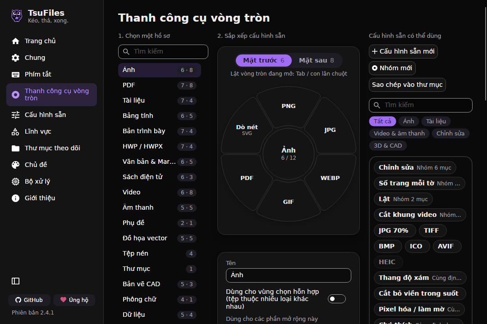

<p align="center"></p>

# TsuFiles

[](https://github.com/tsudev-org/tsufiles/releases/latest)
[](https://github.com/tsudev-org/tsufiles/actions/workflows/ci.yml)
[](LICENSE)
[](https://scorecard.dev/viewer/?uri=github.com/tsudev-org/tsufiles)
[](https://www.bestpractices.dev/projects/16719)

**Trình chuyển đổi tệp ngoại tuyến, miễn phí, mã nguồn mở - tiếng Việt đầy đủ, gia cố bảo mật.**

Một sản phẩm của [TsuDEV](https://tsudev.com).

**Hạng sản phẩm: C - Ngoại tuyến** (theo `.standards/docs/AUTH_AND_ACCOUNT.md` mục 1): mọi chức năng chuyển đổi chạy
trọn vẹn không cần internet và không cần tài khoản; kiểm tra cập nhật là tùy chọn.

Kéo tệp, thả vào một định dạng trên vòng "donut" mở ra ngay tại con trỏ chuột là xong. Hơn 260 định dạng: ảnh, PDF,
Word, Excel, PowerPoint, HWP/HWPX, video, âm thanh, sách điện tử, tệp nén, CAD, bản đồ, 3D... Mọi xử lý chạy **trên
máy của bạn**, không tải tệp lên bất kỳ máy chủ nào, không cần cài Microsoft Office.

<p align="center"></p>

## Cài đặt

| Hệ điều hành | Lệnh |
| --- | --- |
| Windows (Scoop) | `scoop bucket add tsudev https://github.com/tsudev-org/scoop-bucket; scoop install tsudev/tsudev-files` |
| macOS (Homebrew) | `brew install --cask tsudev-org/tap/tsudev-files` |
| Debian, Ubuntu, Fedora, macOS | `curl -fsSL https://tsudev.com/install.sh \| sh -s -- tsudev-files` |

Lệnh một dòng chỉ thêm kho TsuDEV đã ký (APT/DNF, vân tay khóa `3883 10F4 7FA8 224D 76C0 A9C7 9745 B6AF 3EA3 3C74`)
hoặc tap Homebrew rồi để trình quản lý gói tự kiểm và cài; đọc script trước tại <https://tsudev.com/install.sh>. Tải
tay (Windows Setup/Portable, Linux tar.gz, macOS dmg) ở [trang Tải về](https://files.tsudev.com/tai-ve/) hoặc
[GitHub Releases](https://github.com/tsudev-org/tsufiles/releases/latest), kèm `SHA256SUMS` đã ký và chứng thực nguồn
gốc build: `gh attestation verify <tệp> -R tsudev-org/tsufiles`.

## Liên kết

- Tải bản phát hành: <https://github.com/tsudev-org/tsufiles/releases/latest>
- Báo lỗi / đề xuất: <https://github.com/tsudev-org/tsufiles/issues>
- Báo lỗ hổng bảo mật: xem [SECURITY.md](SECURITY.md) (KHÔNG mở issue công khai)
- Ủng hộ dự án: <https://files.tsudev.com/ung-ho/>
- English: [README.en.md](README.en.md)

## Điểm nổi bật

| Hạng mục | TsuFiles |
| --- | --- |
| Ngôn ngữ | Lần chạy đầu **theo ngôn ngữ hệ điều hành** (tiếng Việt nếu hệ điều hành dùng tiếng Việt, còn lại tiếng Anh - chỉ hai ngôn ngữ này) cho giao diện, trình cài đặt và dòng lệnh; đổi trong Cài đặt, chọn lại "Mặc định của hệ thống" để theo hệ điều hành |
| Dòng lệnh `tsufiles` | Tiếng Việt khi hệ thống dùng tiếng Việt, ngoài ra tiếng Anh; `TSUFILES_LANG=vi` / `en` để chọn; khóa JSON ổn định cho script |
| Cập nhật | Chỉ nhận bản phát hành của `tsudev-org/tsufiles` ký bằng **khóa ECDSA P-256 riêng**; tệp khác bị từ chối |
| Nhận diện | Logo con cú, kiểu giao diện Cú đêm ([ADR-0003](docs/adr/0003-ten-san-pham-tsufiles.md)) |
| GitHub Actions | **Ghim theo SHA commit** (chống tag bị sửa) |
| Cổng kiểm bảo mật | CodeQL (security-extended), gitleaks, soát lỗ hổng NuGet, SBOM + chứng thực build, kiểm tra bản dịch, Dependabot |

Chi tiết kiến trúc bảo mật: [docs/vi/KIEN-TRUC-BAO-MAT.md](docs/vi/KIEN-TRUC-BAO-MAT.md).

## Phát triển

Yêu cầu: .NET SDK 10 (`global.json`), Git. Build được trên Windows, Linux và WSL; bộ cài Windows chỉ build trên Windows
(xem [docs/vi/PHAT-HANH.md](docs/vi/PHAT-HANH.md)).

Chuẩn bị một lần sau khi clone (giống CI): phông Noto và engine dùng trong test, đều ghim SHA-256, không vào git.

```bash
dotnet tool install --global PowerShell   # cần cho script build/*.ps1 trên Linux/WSL
pwsh -NoProfile -File build/fetch-fonts.ps1
tools/fetch-engines-linux.sh 7zip         # Windows: pwsh build/fetch-engines.ps1 -Only rhwp,pandoc,7zip,exiftool
```

```bash
dotnet build TsuFiles.slnx
dotnet test tests/TsuFiles.Core.Tests    # các bộ test khác: tests/TsuFiles.*.Tests
# Bộ giao diện chạy riêng, có phát hiện treo (giống CI; khoảng 30-60 phút trên WSL):
dotnet test tests/TsuFiles.App.Tests --no-build --blame-crash --blame-hang-timeout 5m
python3 -I tools/check_i18n_vi.py         # kiểm tra bản dịch tiếng Việt
bash scripts/check-standards.sh           # cổng kiểm quy ước tsudev
```

Chạy dòng lệnh từ mã nguồn:

```bash
dotnet run --project src/TsuFiles.Cli -- help
TSUFILES_LANG=en dotnet run --project src/TsuFiles.Cli -- help
```

Quy ước làm việc (cho người và agent AI): đọc [AGENTS.md](AGENTS.md) trước tiên.

## Bản vá từ upstream

TsuFiles đã tách hẳn khỏi dự án gốc ([ADR-0002](docs/adr/0002-hard-fork-doi-ten-toan-bo-tsudev.md)): không gộp
`upstream/main` nữa. Bản vá bảo mật của upstream được chép thủ công:

```bash
git format-patch -1 <commit> -o /tmp/va                       # từ remote upstream
python3 -I tools/doi-ten-tsudev.py --tep /tmp/va/*.patch       # đổi tên TsuFiles.* -> TsuFiles.*
git apply /tmp/va/*.patch                                      # ghi nguồn (commit upstream) trong thông điệp commit
```

Remote `upstream` đã bị khóa chiều đẩy (`DISABLED`) để không thể vô tình đẩy lên repo gốc.

## Ủng hộ

TsuFiles miễn phí và sẽ luôn miễn phí. Mọi kênh ủng hộ chính thức chỉ được công bố tại
**<https://files.tsudev.com/ung-ho/>** (dữ liệu: [`website/src/data/ung-ho.json`](website/src/data/ung-ho.json)); nút
"Ủng hộ" trong ứng dụng và nút "Sponsor" của GitHub đều trỏ về trang đó. Nhà tài trợ được liệt kê tại đây, trên trang
Ủng hộ và trong trang "Giới thiệu" của ứng dụng.

<!-- sponsors: src/TsuFiles.App/Assets/Sponsors/sponsors.json -->

## Giấy phép và ghi công

Phát hành theo giấy phép MIT - xem [LICENSE](LICENSE). Thành phần bên thứ ba: [THIRD-PARTY-NOTICES.md](THIRD-PARTY-NOTICES.md).
